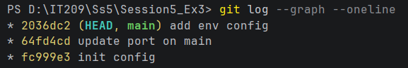

# Báo cáo Bài tập 3: Xử lý xung đột phức tạp trong quá trình Rebase

* **Môn học/Khóa học:** IT209 - Quản lý phiên bản với Git

* **Mã bài tập:** Session 05 - Exercise 3

* **Thư mục nộp bài:** `homework/session_05/ex3/`

## 1. Phân biệt giải quyết xung đột: Merge vs Rebase

| **Tiêu chí** | **Merge (git merge)** | **Rebase (git rebase)** | 
| **Cơ chế hoạt động** | Tìm commit chung gần nhất và kết hợp thay đổi thông qua một **Merge Commit** duy nhất. | Đặt lại điểm mốc (base) của nhánh hiện tại lên đầu commit mới nhất của nhánh đích, sau đó áp dụng (replay) tuần tự từng commit. | 
| **Cách xử lý Conflict** | Gom toàn bộ xung đột lại và xử lý **1 lần duy nhất** trước khi hoàn thành merge commit. | Xung đột phát sinh tại **từng commit cụ thể**, bắt buộc giải quyết từng chặng (step-by-step resolution). | 
| **Hình thái lịch sử commit** | Lịch sử dạng đồ thị rẽ nhánh và chập lại (phi tuyến tính). Giữ nguyên mốc thời gian thực tế. | Lịch sử được làm phẳng thành **một đường thẳng duy nhất** (tuyến tính), không chứa merge commit phụ. | 

## 2. Kịch bản thực nghiệm

1. **Commit gốc trên `main`:**

   * Tạo file `config.json` với cấu hình:

     ```
     {
       "port": 8080,
       "debug": false
     }
     
     ```

   * Commit: `init config`.

2. **Nhánh `feature-api` thực hiện 2 thay đổi:**

   * Đổi `"port": 9000` $\rightarrow$ commit: `feat: change port`.

   * Đổi `"debug": true` $\rightarrow$ commit: `feat: enable debug`.

3. **Nhánh `main` bổ sung 2 thay đổi độc lập từ thành viên khác:**

   * Sửa `"port": 8081` $\rightarrow$ commit: `update port on main`.

   * Bổ sung cấu hình môi trường `"env": "production"` $\rightarrow$ commit: `add env config`.

## 3. Nhật ký giải quyết xung đột chi tiết qua từng chặng

Tiến hành rebase nhánh `feature-api` lên `main`:

```
git checkout feature-api
git rebase main

```

### Chặng 1: Xung đột tại commit `feat: change port`

* **Hiện tượng:** Git tạm dừng rebase, hiển thị tệp `config.json` ở trạng thái xung đột (`both modified`).

* **Nguyên nhân:**

  * Nhánh `main` hiện thời đã nhận giá trị `"port": 8081` và bổ sung thêm khóa `"env": "production"`.

  * Commit `feat: change port` ghi đè giá trị `"port": 9000` trên nền commit cũ ban đầu, dẫn đến xung đột nội dung cùng vị trí.

* **Nội dung xung đột trong tệp:**

  ```
  <<<<<<< HEAD
  {
    "port": 8081,
    "debug": false,
    "env": "production"
  }
  =======
  {
    "port": 9000,
    "debug": false
  }
  >>>>>>> feat: change port
  
  ```

* **Phương án xử lý:**

  * Giữ lại cổng mới của tính năng API (`9000`), đồng thời tích hợp thêm trường cấu hình môi trường (`"env": "production"`) từ nhánh chính.

  * Nội dung tệp sau khi chỉnh sửa thủ công:

    ```
    {
      "port": 9000,
      "debug": false,
      "env": "production"
    }
    
    ```

* **Lệnh hoàn thành chặng 1:**

  ```
  git add config.json
  git rebase --continue
  
  ```

### Chặng 2: Xung đột tại commit `feat: enable debug`

* **Hiện tượng:** Git tiếp tục tạm dừng và báo conflict lần thứ hai tại tệp `config.json`.

* **Nguyên nhân:** Commit thứ hai cố gắng bật cờ `"debug": true`, mâu thuẫn trực tiếp với trạng thái `"debug": false` vừa được ghi nhận ở chặng 1.

* **Nội dung xung đột trong tệp:**

  ```
  <<<<<<< HEAD
  {
    "port": 9000,
    "debug": false,
    "env": "production"
  }
  =======
  {
    "port": 9000,
    "debug": true
  }
  >>>>>>> feat: enable debug
  
  ```

* **Phương án xử lý:**

  * Đồng bộ đầy đủ các tham số theo yêu cầu: giữ nguyên `"port": 9000`, bật `"debug": true`, và duy trì `"env": "production"`.

  * Nội dung tệp sau khi chỉnh sửa thủ công:

    ```
    {
      "port": 9000,
      "debug": true,
      "env": "production"
    }
    
    ```

* **Lệnh hoàn thành chặng 2:**

  ```
  git add config.json
  git rebase --continue
  
  ```

* **Thông báo từ Git:**

  ```
  Applying: feat: enable debug
  Successfully rebased and updated refs/heads/feature-api.
  
  ```

## 4. Kết quả nghiệm thu

### Cấu hình `config.json` cuối cùng

```
{
  "port": 9000,
  "debug": true,
  "env": "production"
}

```

### Lịch sử Git (`git log --graph --oneline`)

```
* 7f9a12c (HEAD -> feature-api) feat: enable debug
* 3b8e41a feat: change port
* a1c45d2 (main) add env config
* 9e102f8 update port on main
* e2b11aa init config

```

> **Đánh giá:**
>
> * Lịch sử hoàn toàn thẳng hàng, không xuất hiện các nhánh rẽ hay commit dạng `Merge branch...`.
>
> * Hai commit tính năng của nhánh `feature-api` được gắn nối tiếp ngay sau commit mới nhất của nhánh `main`.

## 5. Ảnh chụp minh chứng

